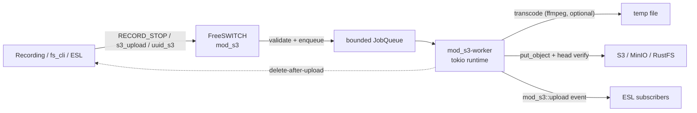

<p align="right">
  <a href="README.md">English</a> | <a href="README_ZH.md">简体中文</a>
</p>

<h1 align="center">mod_s3</h1>

<p align="center">
  <strong>FreeSWITCH S3 Recording Upload Module — self-developed in Rust</strong>
</p>

<p align="center">
  <a href="https://www.rust-lang.org"></a>
  <a href="LICENSE"></a>
  <a href="https://github.com/tangyu-dch/mod_s3"></a>
</p>

---

**mod_s3** uploads FreeSWITCH call recordings to S3-compatible object
storage (MinIO / RustFS / AWS S3) from inside the FreeSWITCH process —
with optional ffmpeg transcoding, delete-after-upload, automatic
`RECORD_STOP` triggers, and session-aware `uuid_s3` commands. It replaces
the HTTP sidecar hop with an in-process, event-driven pipeline.

> [!NOTE]
> This is a **self-developed** Rust implementation. Core logic lives in
> the protocol-agnostic `s3-core` crate; all FreeSWITCH interaction is
> confined to the `mod-s3` fswtch glue layer.

---

## 📋 Table of Contents

- [Features](#-features)
- [Architecture](#-architecture)
- [Quick Start](#-quick-start)
- [API Reference](#-api-reference)
- [Documentation](#-documentation)
- [Known Limitations](#-known-limitations)
- [Testing](#-testing)
- [License](#-license)

---

## ✨ Features

### ☁️ S3 Upload Pipeline
- `put_object` / multipart upload + `head_object` verify (size + sha256
  metadata), powered by `aws-sdk-s3` (ring TLS, no aws-lc) behind a
  narrow `ObjectStore` trait — swappable for a hand-rolled SigV4 PUT
  later without touching the glue layer.
- Streaming file read via `ByteStream::from_path`; sha256 is computed
  before upload and embedded as object metadata.
- Task-level retries (`job-retries`) over a bounded queue — API and
  event threads never block on network I/O.

### 🎙 Recording Triggers
- **Automatic**: binds `SWITCH_EVENT_RECORD_STOP`; every finished
  recording is validated, templated, and enqueued.
- **Manual**: `s3_upload` (global) and `uuid_s3` (session-aware — pulls
  channel variables for key templating, degrading gracefully when the
  session is gone).

### 🎚 Transcode & Lifecycle
- Optional ffmpeg subprocess transcoding (`none` / `auto` / `ffmpeg`
  modes; mp3 / opus / ogg / wav targets with sane defaults, fully
  overridable via `ffmpeg-args`).
- Process-group kill on timeout; stderr tail captured into failure
  events; temp artifacts always cleaned up.
- Delete-after-upload (default off) with a second pathguard check
  against TOCTOU; delete-on-failure stays off by default for forensics.

### 🛡 Safety Rails
- `openat` + `O_NOFOLLOW` component-wise walk: symlink escapes are
  impossible even if a path is swapped between check and open.
- Allowed-roots whitelist, extension whitelist, size cap, and mtime
  minimum-age (guards against reading half-written recordings).
- Credentials prefer `MOD_S3_*` environment variables over conf values.

---

## 🏛 Architecture

```
┌──────────────────────────────────────────────────────────────────┐
│  FreeSWITCH                                                        │
│   ┌───────────────┐   RECORD_STOP    ┌───────────────────────────┐ │
│   │  recorder /   │ ───────────────► │  mod_s3 (Rust cdylib)      │ │
│   │  ESL client   │                  │  api.rs / recorder.rs      │ │
│   └───────┬───────┘                  │  enqueue.rs → JobQueue     │ │
│           │ s3_upload / uuid_s3      │  worker.rs → tokio runtime │ │
│           ▼                          └───────────┬───────────────┘ │
│   ┌───────────────┐                              │                  │
│   │  ESL / fs_cli │ ◄── mod_s3::queued/upload ───┤                  │
│   └───────────────┘     (CUSTOM events)          ▼                  │
│                                              s3-core               │
│                                   pathguard / keytemplate /        │
│                                   sha256 / transcode(ffmpeg) /    │
│                                   uploader(aws-sdk-s3)            │
└──────────────────────────────────────────────────────────────────┘
                                  │ HTTPS (SigV4)
                                  ▼
                    ┌───────────────────────────┐
                    │  S3 / MinIO / RustFS      │
                    └───────────────────────────┘
```



---

## 🚀 Quick Start

### Prerequisites

| dependency | version | notes |
| --- | --- | --- |
| Rust toolchain | stable | `cargo build` |
| `libclang` | any recent | fswtch-sys bindgen at build time |
| FreeSWITCH | 1.10+ | module loaded via `modules.conf.xml` |
| ffmpeg | optional | only when `transcode != none`; static binary mount recommended |

### Build

```bash
cd mod_s3

cargo build --release -p mod-s3
# → target/release/libmod_s3.so

cargo test --workspace   # 28 unit tests
```

### Install & verify

```bash
install -m 0755 target/release/libmod_s3.so ${FS_PREFIX}/mod/mod_s3.so
# add <load module="mod_s3"/> to autoload_configs/modules.conf.xml
# place conf/autoload_configs/mod_s3.conf.xml (see docs/en/DEPLOYMENT.md)
# restart FreeSWITCH, then:
./scripts/verify-deployment.sh
```

Full configuration reference, ffmpeg provisioning options, and the
deployment checklist: **[docs/en/DEPLOYMENT.md](docs/en/DEPLOYMENT.md)**.

---

## 🔌 API Reference

```
s3_upload <path> [bucket] [key|filename] [format] [delete] [metadata]
uuid_s3 <uuid> upload <path> [format] [bucket] [key|filename] [delete] [metadata]
uuid_s3 <uuid> jobs [status] | cancel <job_id>
s3_jobs [status]          # queued|running|done|failed|cancelled
s3_cancel <job_id>
s3_presign <get|put> <key> [bucket] [expires_secs]
```

| parameter | values | default |
| --- | --- | --- |
| `path` | absolute or relative to `recordings-root` | required |
| `format` | `mp3` / `opus` / `ogg` / `wav` / `orig` | config `target-format` |
| `delete` | `1/true/yes/on/delete` or `0/false/no/off/keep` | config `delete-after-upload` |
| `metadata` | JSON fragment echoed into `mod_s3::upload` | none |

All commands return immediately (`+OK job=<id>`); validation failures
return `-ERR` synchronously. Arguments containing spaces must be
single-quoted (FreeSWITCH convention).

Events: `mod_s3::queued` / `mod_s3::upload` / `mod_s3::progress` /
`mod_s3::record_start`. The `key` arg doubles as a filename shorthand
(plain names get the configured directory template + destination
extension). Full command semantics, key-template variables, and event
payloads: **[docs/en/ESL_GUIDE.md](docs/en/ESL_GUIDE.md)**.

---

## 📚 Documentation

| document | contents |
| --- | --- |
| [docs/en/DEPLOYMENT.md](docs/en/DEPLOYMENT.md) | build, install, `mod_s3.conf.xml` reference, ffmpeg options, verify, troubleshooting |
| [docs/en/ESL_GUIDE.md](docs/en/ESL_GUIDE.md) | API commands, key templates, events, timing rules |
| [docs/zh/](docs/zh/) | 中文版上述文档 |
| [README_ZH.md](README_ZH.md) | 简体中文 README |

---

## ⚠️ Known Limitations

| limitation | status | workaround |
| --- | --- | --- |
| Multipart peak memory (~128 MiB transient per batch) | 32 MiB parts × 4-way parallel | recordings rarely exceed the 256 MiB threshold; lower threshold scope if needed |
| RECORD_STOP header field names | `Record-File-Path` confirmed in FS source; candidate list + header dump on miss | verify on target version; fall back to `s3_upload` |
| ffmpeg not bundled in FS image | mount static binary or apt install | `transcode=none` needs no ffmpeg at all |

Details: [docs/en/DEPLOYMENT.md](docs/en/DEPLOYMENT.md#known-limitations).

---

## 🧪 Testing

```bash
cargo test --workspace
```

34 unit tests covering pathguard (symlink escape, roots, size/age/ext),
key-template rendering and sanitization, sha256, job queue/registry,
transcode (arg presets, fake-ffmpeg, timeout kill), config parsing,
and `separate_args` splitting.

`scripts/verify-deployment.sh` performs post-install verification on a
live FreeSWITCH host (`FS_CLI`/`FS_PREFIX` env overrides supported).

---

## 📄 License

[AGPL-3.0](LICENSE) — see [LICENSE](LICENSE) for the full text.
