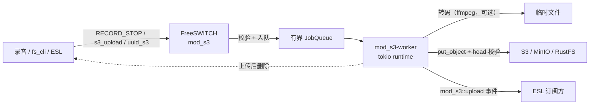

<p align="right">
  <a href="README.md">English</a> | <a href="README_ZH.md">简体中文</a>
</p>

<h1 align="center">mod_s3</h1>

<p align="center">
  <strong>FreeSWITCH S3 录音上传模块 —— Rust 自研实现</strong>
</p>

<p align="center">
  <a href="https://www.rust-lang.org"></a>
  <a href="LICENSE"></a>
  <a href="https://github.com/tangyu-dch/mod_s3"></a>
</p>

---

**mod_s3** 在 FreeSWITCH 进程内把通话录音直传 S3 兼容对象存储
（MinIO / RustFS / AWS S3）——支持可选 ffmpeg 转码、上传后删除、
`RECORD_STOP` 自动上传和会话感知的 `uuid_s3` 命令。用进程内、
事件驱动的流水线替代 HTTP sidecar 中转。

> [!NOTE]
> 本模块为**自研** Rust 实现。核心逻辑位于协议无关的 `s3-core`
> crate；所有 FreeSWITCH 交互都封装在 `mod-s3` fswtch 胶水层。

---

## 📋 目录

- [特性](#-特性)
- [架构](#-架构)
- [快速开始](#-快速开始)
- [API 参考](#-api-参考)
- [文档](#-文档)
- [已知限制](#-已知限制)
- [测试](#-测试)
- [许可证](#-许可证)

---

## ✨ 特性

### ☁️ S3 上传流水线
- `put_object` / multipart 分片上传 + `head_object` 校验（size +
  sha256 metadata），由 `aws-sdk-s3`（ring TLS，无 aws-lc）驱动，
  外层包一层窄 `ObjectStore` trait——将来可平替为手写 SigV4 PUT，
  不影响胶水层。
- `ByteStream::from_path` 流式读文件；sha256 上传前算好并写入
  object metadata。
- 有界队列 + 任务级重试（`job-retries`）——API 与事件线程
  绝不阻塞在网络 IO 上。

### 🎙 录音触发
- **自动**：绑定 `SWITCH_EVENT_RECORD_STOP`，录音结束自动
  校验、渲染 key、入队。
- **手动**：`s3_upload`（全局）与 `uuid_s3`（会话级——自动取
  channel variables 渲染 key，会话消失时优雅降级）。

### 🎚 转码与生命周期
- 可选 ffmpeg 子进程转码（`none` / `auto` / `ffmpeg` 模式；
  mp3 / opus / ogg / wav 目标带默认档位，`ffmpeg-args` 可整体覆盖）。
- 超时按进程组强杀；stderr 尾部进入失败事件；临时产物必清理。
- 上传后删除（默认关）：删除前二次 pathguard 校验防 TOCTOU；
  失败删除默认关，保留现场便于排查。

### 🛡 安全边界
- `openat` + `O_NOFOLLOW` 逐段打开：即使 check 与 open 之间路径
  被替换，符号链接逃逸也不可能发生。
- allowed-roots 白名单、扩展名白名单、大小上限、mtime 最小年龄
  （防读到写了一半的录音）。
- 凭证优先 `MOD_S3_*` 环境变量，conf 值仅兜底。

---

## 🏛 架构

```
┌──────────────────────────────────────────────────────────────────┐
│  FreeSWITCH                                                        │
│   ┌───────────────┐   RECORD_STOP    ┌───────────────────────────┐ │
│   │  recorder /   │ ───────────────► │  mod_s3 (Rust cdylib)      │ │
│   │  ESL client   │                  │  api.rs / recorder.rs      │ │
│   └───────┬───────┘                  │  enqueue.rs → JobQueue     │ │
│           │ s3_upload / uuid_s3      │  worker.rs → tokio runtime │ │
│           ▼                          └───────────┬───────────────┘ │
│   ┌───────────────┐                              │                  │
│   │  ESL / fs_cli │ ◄── mod_s3::queued/upload ───┤                  │
│   └───────────────┘     (CUSTOM events)          ▼                  │
│                                              s3-core               │
│                                   pathguard / keytemplate /        │
│                                   sha256 / transcode(ffmpeg) /    │
│                                   uploader(aws-sdk-s3)            │
└──────────────────────────────────────────────────────────────────┘
                                  │ HTTPS (SigV4)
                                  ▼
                    ┌───────────────────────────┐
                    │  S3 / MinIO / RustFS      │
                    └───────────────────────────┘
```



---

## 🚀 快速开始

### 前置依赖

| 依赖 | 版本 | 说明 |
| --- | --- | --- |
| Rust 工具链 | stable | `cargo build` |
| `libclang` | 较新版本 | 构建期 fswtch-sys bindgen |
| FreeSWITCH | 1.10+ | 经 `modules.conf.xml` 加载 |
| ffmpeg | 可选 | 仅 `transcode != none` 时需要；推荐挂载静态二进制 |

### 构建

```bash
cd mod_s3

cargo build --release -p mod-s3
# → target/release/libmod_s3.so

cargo test --workspace   # 28 项单元测试
```

### 安装与验证

```bash
install -m 0755 target/release/libmod_s3.so ${FS_PREFIX}/mod/mod_s3.so
# 在 autoload_configs/modules.conf.xml 增加 <load module="mod_s3"/>
# 放置 conf/autoload_configs/mod_s3.conf.xml（见 docs/zh/DEPLOYMENT.md）
# 重启 FreeSWITCH，然后：
./scripts/verify-deployment.sh
```

完整配置参考、ffmpeg 引入方式与部署清单：
**[docs/zh/DEPLOYMENT.md](docs/zh/DEPLOYMENT.md)**。

---

## 🔌 API 参考

```
s3_upload <path> [bucket] [key|文件名] [format] [delete] [metadata]
uuid_s3 <uuid> upload <path> [format] [bucket] [key|文件名] [delete] [metadata]
uuid_s3 <uuid> jobs [status] | cancel <job_id>
s3_jobs [status]          # queued|running|done|failed|cancelled
s3_cancel <job_id>
s3_presign <get|put> <key> [bucket] [expires_secs]
```

| 参数 | 取值 | 默认 |
| --- | --- | --- |
| `path` | 绝对路径或相对 `recordings-root` | 必填 |
| `format` | `mp3` / `opus` / `ogg` / `wav` / `orig` | 配置 `target-format` |
| `delete` | `1/true/yes/on/delete` 或 `0/false/no/off/keep` | 配置 `delete-after-upload` |
| `metadata` | JSON 片段，透传进 `mod_s3::upload` 事件 | 无 |

所有命令立即返回（`+OK job=<id>`）；校验失败同步返回 `-ERR`。
参数含空格时用 FreeSWITCH 单引号包裹。

事件：`mod_s3::queued` / `mod_s3::upload` / `mod_s3::progress` /
`mod_s3::record_start`。`key` 参数兼作文件名简写（普通文件名自动套
目录模板并跟随目标格式扩展名）。完整命令语义、key 模板变量与事件
报文：**[docs/zh/ESL_GUIDE.md](docs/zh/ESL_GUIDE.md)**。

---

## 📚 文档

| 文档 | 内容 |
| --- | --- |
| [docs/zh/DEPLOYMENT.md](docs/zh/DEPLOYMENT.md) | 构建、安装、`mod_s3.conf.xml` 参考、ffmpeg 方案、验证、故障排查 |
| [docs/zh/ESL_GUIDE.md](docs/zh/ESL_GUIDE.md) | API 命令、key 模板、事件、时序规则 |
| [docs/en/](docs/en/) | English versions of the above |
| [README.md](README.md) | English README |

---

## ⚠️ 已知限制

| 限制 | 状态 | 规避方式 |
| --- | --- | --- |
| multipart 峰值内存（每批约 128 MiB 瞬时） | 32 MiB 分片 × 4 路并行 | 录音很少超过 256 MiB 阈值；介意可收窄触发范围 |
| RECORD_STOP 事件头字段名 | FS 源码已确认 `Record-File-Path`；另有候选列表 + miss 时头 dump | 目标版本实测确认；兜底用 `s3_upload` |
| FF 镜像不自带 ffmpeg | 挂载静态二进制或 apt 安装 | `transcode=none` 时完全不需要 |

详见 [docs/zh/DEPLOYMENT.md](docs/zh/DEPLOYMENT.md#已知限制)。

---

## 🧪 测试

```bash
cargo test --workspace
```

34 项单元测试覆盖 pathguard（符号链接逃逸、roots、size/age/ext）、
key 模板渲染与字符收敛、sha256、任务队列/注册表、转码（参数档位、
假 ffmpeg、超时强杀）、配置解析与 `separate_args` 拆分。

`scripts/verify-deployment.sh` 在真实 FreeSWITCH 上做安装后验证
（支持 `FS_CLI`/`FS_PREFIX` 环境变量覆盖）。

---

## 📄 许可证

[AGPL-3.0](LICENSE) —— 完整文本见 [LICENSE](LICENSE)。
